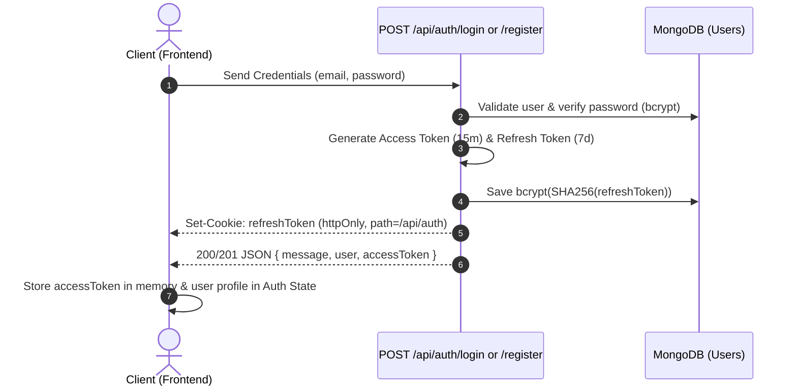
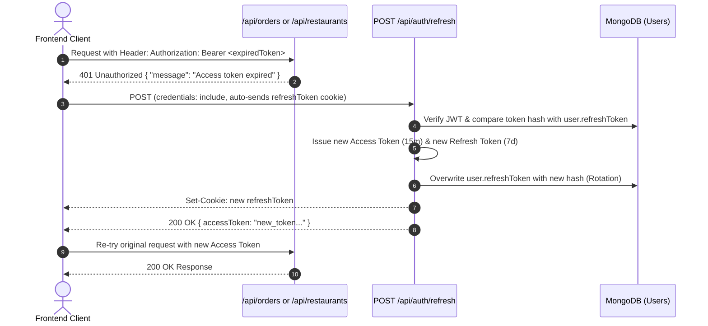

# Authentication & Authorization Flow

FoodHub implements an enterprise-grade dual-token authentication model combining **short-lived Access Tokens** and **rotated, HttpOnly Refresh Tokens**.

---

## 1. Token Specifications

| Token | Lifetime | Storage Location | Transport Mechanism | Payload | Purpose |
| :--- | :--- | :--- | :--- | :--- | :--- |
| **Access Token** | `15m` | In-Memory (JavaScript state) | `Authorization: Bearer <token>` | `{ id, role, exp, iat }` | Authenticates API requests against protected endpoints |
| **Refresh Token** | `7d` | Browser Cookie Store (`httpOnly`) | Sent automatically by browser to `/api/auth/*` | `{ id, exp, iat }` | Obtains new access tokens; undergoes rotation on every use |

### Refresh Cookie Security Attributes
- `httpOnly: true` (Inaccessible to client-side scripts via `document.cookie`)
- `sameSite: "strict"` (Mitigates CSRF vulnerabilities)
- `secure: isProduction` (`true` in production via HTTPS, `false` in development)
- `path: "/api/auth"` (The browser transmits this cookie **strictly** to `/api/auth/*` routes, preventing unnecessary cookie leakage on general API calls)

### Storage Security: SHA-256 Pre-Hash Digest
Because bcrypt evaluates only the first 72 bytes of its input and all user JWT headers share identical prefix bytes, the backend hashes refresh tokens in two stages before saving them to MongoDB:
1. `digest = crypto.createHash("sha256").update(token).digest("hex")` (64 characters)
2. `bcrypt.hash(digest, 10)` saved into `user.refreshToken`

---

## 2. Authentication Flows

### 2.1 Registration & Login Flow



#### Registration Endpoint: `POST /api/auth/register`
- **Request Body**:
  ```json
  {
    "name": "Aarav Sharma",
    "email": "aarav.sharma@example.com",
    "password": "securepassword123",
    "role": "customer", // optional: "customer" (default) or "owner"
    "city": "Bhopal"     // optional
  }
  ```
- **Response `201 Created`**:
  ```json
  {
    "message": "Registered successfully",
    "user": {
      "id": "67236b280100000000000001",
      "name": "Aarav Sharma",
      "email": "aarav.sharma@example.com",
      "role": "customer",
      "city": "Bhopal",
      "createdAt": "2026-10-31T10:00:00.000Z"
    },
    "accessToken": "eyJhbGciOiJIUzI1NiIsInR5cCI6IkpXVCJ9..."
  }
  ```

#### Login Endpoint: `POST /api/auth/login`
- **Request Body**:
  ```json
  {
    "email": "aarav.sharma@example.com",
    "password": "securepassword123"
  }
  ```
- **Response `200 OK`**: Same payload as registration.

---

### 2.2 Token Expiry & Silent Refresh Flow (Rotation)

Every time an access token expires (`401 { message: "Access token expired" }`), the client must invoke `POST /api/auth/refresh`.



> [!WARNING]
> **Refresh Token Rotation**:
> The moment `/api/auth/refresh` is called, the previous refresh token is overwritten in the database. If an outdated or revoked refresh token is presented, the server clears the cookie and returns `401 { "message": "Invalid refresh token" }`.

---

### 2.3 Logout Flow

#### Endpoint: `POST /api/auth/logout`
- **Behavior**:
  1. Reads `req.cookies.refreshToken`.
  2. If present and valid, sets `user.refreshToken = null` in the database.
  3. Returns `Set-Cookie` with expired date to clear cookie from browser.
  4. Responds with `200 OK { "message": "Logged out successfully" }`.

---

### 2.4 Active Profile Verification

#### Endpoint: `GET /api/auth/me`
- **Headers**: `Authorization: Bearer <accessToken>`
- **Response `200 OK`**:
  ```json
  {
    "user": {
      "id": "67236b280100000000000001",
      "name": "Aarav Sharma",
      "email": "aarav.sharma@example.com",
      "role": "customer",
      "city": "Bhopal",
      "createdAt": "2026-10-31T10:00:00.000Z"
    }
  }
  ```

---

## 3. Role-Based Access Control (RBAC) Matrix

The backend enforces authorization using the `authorize(...roles)` middleware:

| Feature / Endpoint | Role Requirement | Middleware Chain | Access Control Description |
| :--- | :--- | :--- | :--- |
| **Auth Operations** (`register`, `login`, `refresh`, `logout`) | Public | None | Cookie-based or body-based authentication |
| **Fetch Current Profile** (`/api/auth/me`) | Any Authenticated | `authUser` | Requires valid Bearer Access Token |
| **Browse Restaurants & Menus** | Public | None | Public discovery |
| **Browse Restaurant Reviews** | Public | None | Public feedback reading |
| **Place Order** (`POST /api/orders`) | `customer` | `authUser, authorize("customer")` | Restaurant must be `isOpen: true` |
| **View My Orders** (`GET /api/orders/my`) | `customer` | `authUser, authorize("customer")` | Scoped to `req.user.id` |
| **Create Review** (`POST /api/reviews`) | `customer` | `authUser, authorize("customer")` | Order must be owned and `delivered` |
| **Create Restaurant** (`POST /api/restaurants`) | `owner` | `authUser, authorize("owner")` | Assigns `owner: req.user.id` |
| **Update / Delete Restaurant** | `owner` | `authUser, authorize("owner")` | Verifies `restaurant.owner === req.user.id` |
| **Menu CRUD** (`POST`, `PATCH`, `DELETE` menu) | `owner` | `authUser, authorize("owner")` | Verifies restaurant ownership |
| **View Restaurant Orders** (`GET .../orders`) | `owner` | `authUser, authorize("owner")` | Scoped to owned restaurant |
| **Update Order Status** (`PATCH .../status`) | `owner` | `authUser, authorize("owner")` | Order must belong to owned restaurant |
| **View Revenue & Top Customers** | `owner` | `authUser, authorize("owner")` | Scoped to owned restaurant |

---

## 4. Frontend Integration Architecture: Axios Refresh Interceptor

To manage token lifecycle transparently across the frontend application:

```typescript
// frontend/src/lib/api.ts
import axios from "axios";

export const api = axios.create({
  baseURL: "http://localhost:3000",
  withCredentials: true, // Crucial: ensures httpOnly refreshToken cookie is transmitted
});

let isRefreshing = false;
let failedQueue: Array<{
  resolve: (token: string) => void;
  reject: (err: any) => void;
}> = [];

const processQueue = (error: any, token: string | null = null) => {
  failedQueue.forEach((promise) => {
    if (error) {
      promise.reject(error);
    } else if (token) {
      promise.resolve(token);
    }
  });
  failedQueue = [];
};

// 1. Request Interceptor: Attach Access Token
api.interceptors.request.use((config) => {
  const token = localStorage.getItem("accessToken");
  if (token) {
    config.headers.Authorization = `Bearer ${token}`;
  }
  return config;
});

// 2. Response Interceptor: Handle 401 & Silent Rotation
api.interceptors.response.use(
  (response) => response,
  async (error) => {
    const originalRequest = error.config;

    // Detect access token expiration
    if (
      error.response?.status === 401 &&
      error.response?.data?.message === "Access token expired" &&
      !originalRequest._retry
    ) {
      if (isRefreshing) {
        return new Promise((resolve, reject) => {
          failedQueue.push({ resolve, reject });
        })
          .then((newToken) => {
            originalRequest.headers.Authorization = `Bearer ${newToken}`;
            return api(originalRequest);
          })
          .catch((err) => Promise.reject(err));
      }

      originalRequest._retry = true;
      isRefreshing = true;

      try {
        const { data } = await api.post("/api/auth/refresh");
        const newAccessToken = data.accessToken;
        localStorage.setItem("accessToken", newAccessToken);
        
        processQueue(null, newAccessToken);
        originalRequest.headers.Authorization = `Bearer ${newAccessToken}`;
        return api(originalRequest);
      } catch (refreshErr) {
        processQueue(refreshErr, null);
        localStorage.removeItem("accessToken");
        window.location.href = "/login";
        return Promise.reject(refreshErr);
      } finally {
        isRefreshing = false;
      }
    }

    return Promise.reject(error);
  }
);
```

---

## 5. Seeded Demo Accounts

| Role | Email | Password | Pre-seeded Environment |
| :--- | :--- | :--- | :--- |
| **Owner** | `owner@foodhub.com` | `password123` | Owns 10 restaurants in Bhopal, including the primary demo venue with ~5,000 orders |
| **Customer** | `customer@foodhub.com` | `password123` | Active customer based in Bhopal with ~500 historical orders |

