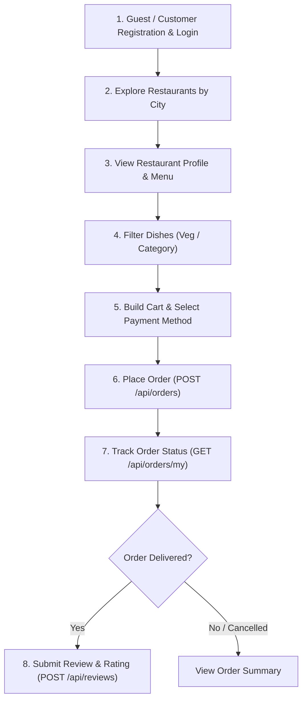

# Customer Experience & Features Specification

This document maps every customer-facing feature to the underlying backend APIs, detailing data contracts, state management, validations, and UI considerations.

---

## 1. Customer User Journey Overview



---

## 2. Feature Breakdown

### 2.1 Registration, Login & Profile Management
Customers authenticate to obtain an access token and initiate an authenticated session.

- **APIs Involved**:
  - `POST /api/auth/register` (sets `role: "customer"`, selects home city)
  - `POST /api/auth/login`
  - `GET /api/auth/me`
  - `POST /api/auth/logout`
- **Data Attributes Saved**:
  - `name`, `email`, `city`, `createdAt`
- **Frontend State**:
  - Store `accessToken` in memory.
  - Cache user profile in persistent auth state (e.g., Zustand or React Context).

---

### 2.2 Restaurant Discovery & City Selection
Customers can discover available dining options filtered by their target city.

- **API Involved**: `GET /api/restaurants?page=1&limit=10&city=Bhopal`
- **Available Cities** (from backend seed configuration):
  - Bhopal, Indore, Delhi, Mumbai, Bengaluru, Pune, Hyderabad, Jaipur
- **Data Provided per Restaurant**:
  - `_id`, `name`, `city`, `area`, `cuisines` (`string[]`), `isOpen` (`boolean`), `location` (`[lng, lat]`)
- **UI Logic**:
  - **City Selector**: Prominent dropdown or modal permitting quick city switching.
  - **Open Status Badge**: Display `"Open Now"` or `"Closed"` based on `restaurant.isOpen`. Closed restaurants remain viewable, but checkout is disabled.
  - **Pagination**: Handle `page`, `totalPages`, and `total` via infinite scroll or structured numeric pagination.

---

### 2.3 Menu Exploration & Filtering
When visiting a restaurant page, customers can browse dishes organized by category and filter by dietary preference.

- **APIs Involved**:
  - `GET /api/restaurants/:id` (Restaurant details, area, cuisines, owner name)
  - `GET /api/restaurants/:id/menu?category=Starters&isVeg=true`
  - `GET /api/restaurants/:id/reviews?page=1&limit=10`
- **Filter Capabilities Supported by Backend**:
  - `category`: String matching exact category name (e.g. `"Starters"`, `"Main Course"`, `"Desserts"`, `"Other"`).
  - `isVeg`: Boolean string query (`"true"` for vegetarian, `"false"` for non-vegetarian).
- **Dish Details Provided**:
  - `_id`, `name`, `category`, `price`, `isVeg` (`true/false`), `isAvailable` (`true/false`)
- **UI Logic**:
  - Dietary toggle: `All`, `Veg Only`, `Non-Veg Only`.
  - Category pill tabs or sticky section navigation.
  - Out-of-Stock handling: If `isAvailable === false`, render disabled state with `"Sold Out"` pill.

---

### 2.4 Cart Management & Order Placement
Customers build a cart containing items from a **single restaurant** and proceed to checkout.

- **API Involved**: `POST /api/orders`
- **Payload Structure**:
  ```json
  {
    "restaurantId": "67236b280200000000000001",
    "paymentMethod": "upi", // "upi" | "card" | "cod"
    "items": [
      {
        "menuItemId": "67236b280300000000000001",
        "quantity": 2
      }
    ]
  }
  ```
- **Backend Rules & Constraints**:
  1. **Quantity Limits**: Each item quantity must be an integer between `1` and `20`.
  2. **Single Restaurant Restriction**: All `menuItemId` values must exist and belong to the specified `restaurantId`. Adding an item from another restaurant in the frontend must prompt to reset the cart.
  3. **Restaurant Operating Status**: If `restaurant.isOpen === false`, the API rejects with `400 { message: "Restaurant is closed right now" }`.
  4. **Item Availability**: Unavailable items (`isAvailable === false`) cause order creation failure.
  5. **Server-side Pricing**: The client does not transmit prices. The server fetches current prices from the database, computes `totalAmount`, and saves an immutable snapshot in the order document.

---

### 2.5 Order Tracking & Order History
Customers can review all active and historical orders.

- **API Involved**: `GET /api/orders/my?page=1&limit=10`
- **Sorting**: Newest first (`createdAt: -1`).
- **Data Provided per Order**:
  - `_id`, `createdAt`, `status`, `paymentMethod`, `totalAmount`
  - `restaurant`: Populated with `name`, `city`, `area`
  - `items`: Snapshot array containing `name`, `price`, `quantity`, and original `menuItem` ID
- **Order Status Lifecycle**:
  - `placed`: Order received by restaurant.
  - `preparing`: Kitchen is preparing the food.
  - `delivered`: Order fulfilled and delivered to customer.
  - `cancelled`: Order cancelled by restaurant.

---

### 2.6 Order Reviews & Ratings
Customers can rate and review meals once their order is fulfilled.

- **API Involved**: `POST /api/reviews`
- **Payload Structure**:
  ```json
  {
    "orderId": "67236b280400000000000001",
    "rating": 5, // Integer: 1, 2, 3, 4, 5
    "comment": "Tender kebabs and authentic biryani aroma!"
  }
  ```
- **Backend Enforced Constraints**:
  - Order must be in `delivered` status (`400` if still placed, preparing, or cancelled).
  - Customer can only review orders they placed (`403` otherwise).
  - Strictly **one** review per order (`409` if duplicate review attempted).
- **UI Logic**:
  - On the Order History page, display a `"Write Review"` button **only** on orders with `status === "delivered"` that do not yet have an associated review.
  - Modal with 5 interactive star selectors and a review text box.

