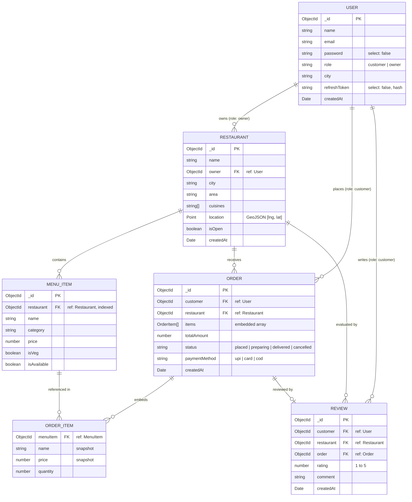

# Data Models Reference

This document provides a comprehensive specification of all MongoDB / Mongoose data models in the FoodHub backend (`src/models/`).

---

## 1. Entity-Relationship Overview



---

## 2. Model Specifications

### 2.1 User Model (`src/models/user.model.js`)

Represents all registered platform actors, differentiated strictly by the `role` field (`"customer"` or `"owner"`).

| Field | Type | Required | Default | Description / Rules |
| :--- | :--- | :--- | :--- | :--- |
| `_id` | `ObjectId` | Auto | Auto | MongoDB identifier |
| `name` | `String` | Yes | - | Full name, `trim: true` |
| `email` | `String` | Yes | - | Email address, `trim: true`, `lowercase: true`. Checked for uniqueness in auth controller |
| `password` | `String` | Yes | - | Bcrypt-hashed password (salt rounds: 10), hidden by default (`select: false`) |
| `role` | `String` | No | `"customer"` | Enum: `["customer", "owner"]` |
| `city` | `String` | No | `undefined` | User home city (e.g., `"Bhopal"`, `"Indore"`, `"Mumbai"`, `trim: true`) |
| `refreshToken` | `String` | No | `null` | Bcrypt hash of the SHA-256 digest of the active refresh token. Hidden by default (`select: false`) |
| `createdAt` | `Date` | Auto | Current Time | Timestamp created automatically (`timestamps: { createdAt: true, updatedAt: false }`) |

> [!NOTE]
> Timestamps are configured with `createdAt: true, updatedAt: false`. Users do not possess an `updatedAt` field.

---

### 2.2 Restaurant Model (`src/models/restaurant.model.js`)

Represents a food establishment managed by a single restaurant owner.

| Field | Type | Required | Default | Description / Rules |
| :--- | :--- | :--- | :--- | :--- |
| `_id` | `ObjectId` | Auto | Auto | MongoDB identifier |
| `name` | `String` | Yes | - | Restaurant display name, `trim: true` |
| `owner` | `ObjectId` | Yes | - | Reference to `User` model (`ref: "User"`). Must have `role: "owner"` |
| `city` | `String` | Yes | - | City name (e.g., `"Bhopal"`, `trim: true`) |
| `area` | `String` | No | `undefined` | Sub-locality or neighborhood (e.g., `"MP Nagar"`, `trim: true`) |
| `cuisines` | `[String]` | No | `[]` | Array of cuisine categories (e.g. `["North Indian", "Biryani"]`) |
| `location` | `PointSchema` | Yes | - | GeoJSON Point schema (see structure below) |
| `isOpen` | `Boolean` | No | `true` | Operational toggle. If `false`, order creation is rejected |
| `createdAt` | `Date` | Auto | Current Time | Timestamp created automatically (`updatedAt: false`) |

#### Sub-schema: `PointSchema`
```javascript
{
  type: { type: String, enum: ["Point"], default: "Point" },
  coordinates: {
    type: [Number], // [longitude, latitude] — Longitude FIRST!
    required: true,
    validate: {
      validator: (value) => value.length === 2,
      message: "coordinates must be [lng, lat]"
    }
  }
}
```

> [!IMPORTANT]
> GeoJSON standards require coordinates to be ordered `[longitude, latitude]`. The backend helper `buildLocation(lng, lat)` enforces `-180 <= lng <= 180` and `-90 <= lat <= 90`.

---

### 2.3 MenuItem Model (`src/models/menuItem.model.js`)

Represents dishes and drinks belonging to a specific restaurant.

| Field | Type | Required | Default | Description / Rules |
| :--- | :--- | :--- | :--- | :--- |
| `_id` | `ObjectId` | Auto | Auto | MongoDB identifier |
| `restaurant` | `ObjectId` | Yes | - | Reference to `Restaurant` (`ref: "Restaurant"`, `index: true`) |
| `name` | `String` | Yes | - | Name of item, `trim: true` |
| `category` | `String` | No | `"Other"` | Category group (e.g., `"Starters"`, `"Main Course"`, `"Desserts"`, `trim: true`) |
| `price` | `Number` | Yes | - | Price in INR (minimum: `0`) |
| `isVeg` | `Boolean` | No | `true` | Dietary classification (`true` = vegetarian, `false` = non-vegetarian) |
| `isAvailable` | `Boolean` | No | `true` | In-stock toggle. If `false`, customers cannot add this item to an order |

> [!NOTE]
> `MenuItem` does not have automatic Mongoose timestamps (`createdAt`/`updatedAt` are omitted in schema).

---

### 2.4 Order Model (`src/models/order.model.js`)

Represents a placed order binding a customer and a restaurant. Contains embedded immutable snapshots of ordered items.

| Field | Type | Required | Default | Description / Rules |
| :--- | :--- | :--- | :--- | :--- |
| `_id` | `ObjectId` | Auto | Auto | MongoDB identifier |
| `customer` | `ObjectId` | Yes | - | Reference to `User` (`ref: "User"`, role: `"customer"`) |
| `restaurant` | `ObjectId` | Yes | - | Reference to `Restaurant` (`ref: "Restaurant"`) |
| `items` | `[OrderItem]` | Yes | - | Embedded array of items. Validation: `items.length > 0` |
| `totalAmount` | `Number` | Yes | - | Sum of `price * quantity` for all items (min: `0`). Calculated server-side |
| `status` | `String` | No | `"placed"` | Enum: `["placed", "preparing", "delivered", "cancelled"]` |
| `paymentMethod` | `String` | No | `"cod"` | Enum: `["upi", "card", "cod"]` |
| `createdAt` | `Date` | Auto | Current Time | Timestamp created automatically (`updatedAt: false`) |

#### Sub-schema: `OrderItemSchema` (embedded, `_id: false`)
```javascript
{
  menuItem: { type: ObjectId, ref: "MenuItem", required: true },
  name: { type: String, required: true },
  price: { type: Number, required: true, min: 0 },
  quantity: { type: Number, required: true, min: 1, max: 20 }
}
```

> [!TIP]
> **Data Integrity Snapshot**: When an order is created, the backend copies the live `name` and `price` from the `MenuItem` document into the embedded order item. Future price updates or menu changes never alter historic order values.

#### Database Indexes
- Compound Index: `{ restaurant: 1, status: 1, customer: 1, totalAmount: 1 }`

---

### 2.5 Review Model (`src/models/review.model.js`)

Represents customer feedback and star ratings on delivered orders.

| Field | Type | Required | Default | Description / Rules |
| :--- | :--- | :--- | :--- | :--- |
| `_id` | `ObjectId` | Auto | Auto | MongoDB identifier |
| `customer` | `ObjectId` | Yes | - | Reference to `User` (`ref: "User"`) |
| `restaurant` | `ObjectId` | Yes | - | Reference to `Restaurant` (`ref: "Restaurant"`) |
| `order` | `ObjectId` | Yes | - | Reference to `Order` (`ref: "Order"`). Checked for 1-to-1 uniqueness in controller |
| `rating` | `Number` | Yes | - | Whole integer from `1` to `5` (`min: 1, max: 5`) |
| `comment` | `String` | No | `""` | Review commentary, `trim: true` |
| `createdAt` | `Date` | Auto | Current Time | Timestamp created automatically (`updatedAt: false`) |

---

## 3. Data Integrity & Validation Constraints

1. **Email Uniqueness**: Checked manually in `auth.controller.js` by querying `User.findOne({ email })`. Returns `409 Conflict` if existing.
2. **Order Item Availability**: Before placing an order, the server verifies `MenuItem.isAvailable === true` and ensures every item belongs to the target restaurant.
3. **Order Status Transitions**: Strict finite state machine in `order.controller.js`.
4. **Delivered Review Prerequisite**: Reviews can only be created for orders where `status === "delivered"`. One review per order.
5. **Ownership Isolation**: Every mutating restaurant or menu action uses `findOwnedRestaurant(restaurantId, userId)`:
   - Returns `404` if restaurant does not exist.
   - Returns `403` if `restaurant.owner.toString() !== userId`.

