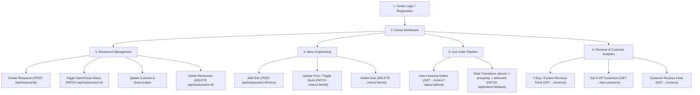

# Restaurant Owner Experience & Features Specification

This document details all capabilities available to users with the `owner` role, mapping operational workflows to backend endpoints and validation rules.

---

## 1. Owner Workflow Overview



---

## 2. Feature Breakdown

### 2.1 Restaurant Administration (CRUD)
An owner can create and manage multiple restaurant profiles.

- **APIs Involved**:
  - `POST /api/restaurants` (Create restaurant)
  - `PATCH /api/restaurants/:id` (Update restaurant)
  - `DELETE /api/restaurants/:id` (Delete restaurant)
  - `GET /api/restaurants/:id` (View restaurant profile)
- **Data Contracts**:
  - **Create Restaurant Request Body**:
    ```json
    {
      "name": "Bhopal Royal Rasoi",
      "city": "Bhopal",
      "area": "MP Nagar Zone 1",
      "cuisines": ["North Indian", "Mughlai", "Biryani"],
      "lng": 77.4126,
      "lat": 23.2599,
      "isOpen": true
    }
    ```
- **Operational Status Toggle**:
  - Owners can instantaneously pause incoming orders by setting `isOpen: false` via `PATCH /api/restaurants/:id`.
  - When `isOpen` is `false`, the customer order endpoint (`POST /api/orders`) automatically rejects order placement attempts with `400 { message: "Restaurant is closed right now" }`.
- **Cascading Deletion**:
  - Invoking `DELETE /api/restaurants/:id` removes the restaurant and executes `MenuItem.deleteMany({ restaurant: restaurant._id })`, purging all menu items while preserving order history for financial records.

---

### 2.2 Menu Engineering (Menu CRUD)
Owners have full control over dishes, categorization, pricing, dietary flags, and stock availability.

- **APIs Involved**:
  - `GET /api/restaurants/:id/menu` (View current menu)
  - `POST /api/restaurants/:id/menu` (Add dish)
  - `PATCH /api/restaurants/:id/menu/:itemId` (Update dish)
  - `DELETE /api/restaurants/:id/menu/:itemId` (Delete dish)
- **Data Contracts**:
  - **Create Menu Item**:
    ```json
    {
      "name": "Paneer Tikka Angara",
      "category": "Starters",
      "price": 280,
      "isVeg": true,
      "isAvailable": true
    }
    ```
- **Instant In-Stock / Out-of-Stock Toggle**:
  - Owners can toggle dish availability in real time with `PATCH /api/restaurants/:id/menu/:itemId` passing `{ "isAvailable": false }`.
  - If a dish is unavailable, customers cannot add it to an order.
- **Price Integrity**:
  - Modifying a dish price applies **strictly to future orders**. Past orders preserve their historic price snapshots inside the `Order.items` array.

---

### 2.3 Live Kitchen & Order Pipeline
Owners manage incoming orders, track kitchen preparation, and update delivery states.

- **APIs Involved**:
  - `GET /api/restaurants/:id/orders?page=1&limit=10&status=placed`
  - `PATCH /api/orders/:id/status`
- **Ownership Verification**:
  - For every order modification, the backend executes `findOwnedRestaurant(order.restaurant, req.user.id)`. Non-owners receive `403 Forbidden`.
- **State Machine Transitions**:
  ```
  [ placed ]  ----(Accept)---->  [ preparing ]  ----(Dispatch)---->  [ delivered ] (Terminal)
      |                                |
      +----------(Cancel)--------------+-------------------------->  [ cancelled ] (Terminal)
  ```
- **Allowed Status Matrix**:
  | Current Status | Allowed Target Statuses | Backend Action |
  | :--- | :--- | :--- |
  | `placed` | `"preparing"`, `"cancelled"` | Owner accepts order into kitchen or rejects it |
  | `preparing` | `"delivered"`, `"cancelled"` | Owner marks food delivered or cancels order |
  | `delivered` | None | Final state; unlocks customer review capability |
  | `cancelled` | None | Final state |

- **UI Dashboard Design**:
  - Kanban board or tabbed queue:
    1. **New Orders (`placed`)**: Action buttons `Accept (Prepare)` and `Reject (Cancel)`.
    2. **In Kitchen (`preparing`)**: Action button `Mark Delivered`.
    3. **Completed (`delivered`)**: Read-only history card.
    4. **Cancelled (`cancelled`)**: Read-only history card.

---

### 2.4 Revenue & Performance Analytics
Owners can monitor business health via working aggregation endpoints.

- **APIs Involved**:
  - `GET /api/restaurants/:id/revenue?from=2026-10-24&to=2026-10-31`
  - `GET /api/restaurants/:id/top-customers`
  - `GET /api/restaurants/:id/reviews?page=1&limit=10`

#### Revenue Analytics
- Returns aggregate earnings across delivered orders over a given date range (defaults to the last 7 days).
- **Response Structure**:
  ```json
  {
    "message": "Revenue data fetched successfully",
    "revenue": 34850,
    "from": "2026-10-24",
    "to": "2026-10-31",
    "days": [
      { "date": "2026-10-24", "revenue": 4500 },
      { "date": "2026-10-25", "revenue": 5200 }
    ]
  }
  ```
- **UI Rendering**: Interactive daily revenue bar chart and trend indicator.

#### VIP Top Customers
- Identifies the top 5 highest-spending customers for the restaurant based on delivered orders.
- **Metrics Provided**:
  - `totalRevenue`: Lifetime spending at this restaurant.
  - `totalOrder`: Number of delivered orders placed.
  - `averageOrderValue`: Mean spend per order.
  - `user`: Customer name and email.
- **UI Rendering**: Leaderboard table recognizing repeat diners.

#### Reputation & Reviews
- Feed of all customer reviews showing star ratings (1 to 5), customer names, timestamps, and feedback comments.

